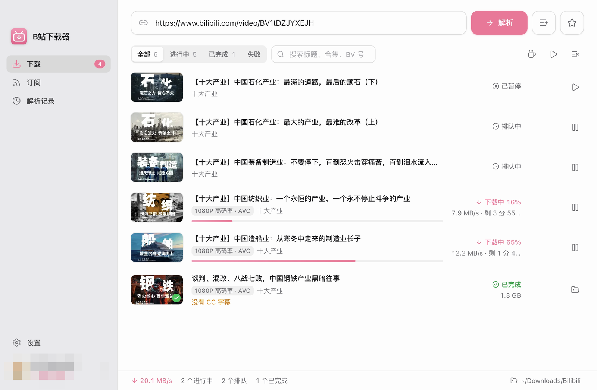
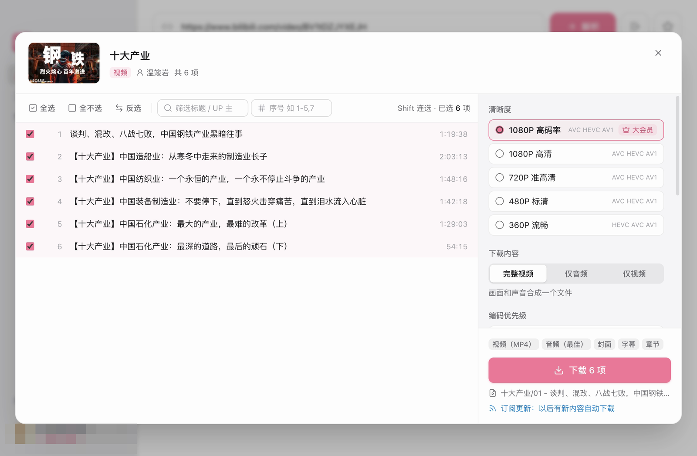

<div align="center">


# Bili Downloader

**好きな bilibili 動画を、自分のドライブへ。** リンクをコピーして、貼って、ダウンロードを押すだけ。動画もコレクションもアニメも講座もまとめて一気に落とせて、画質は最大 8K / Dolby Vision、字幕・弾幕・チャプターも一緒に保存されます。ついでに AI でウォーターマークを消したり、面倒な作業を AI エージェントにまかせたりもできます。Windows・macOS・Linux 対応の無料オープンソースです。

[](https://github.com/wangzi6224/bili-downloader/releases/latest)
[](https://github.com/wangzi6224/bili-downloader/releases)
[](https://github.com/wangzi6224/bili-downloader/stargazers)
[](LICENSE)

[](https://github.com/wangzi6224/bili-downloader/releases/latest)
[](https://github.com/wangzi6224/bili-downloader/releases/latest)
[](https://github.com/wangzi6224/bili-downloader/releases/latest)

**[公式サイト](https://wangzi6224.github.io/bili-downloader/)** · **[ダウンロード](https://github.com/wangzi6224/bili-downloader/releases/latest)** · **[使ってみる](#4-ステップではじめよう)** · **[AI におまかせ（MCP）](#ダウンロードは-ai-におまかせmcp)** · **[よくある質問](#よくある質問)**

[English](README.md) | [简体中文](README.zh-CN.md) | **日本語** | [한국어](README.ko.md) | [Français](README.fr.md) | [Italiano](README.it.md) | [Русский](README.ru.md) | [हिन्दी](README.hi.md)

<a href="https://trendshift.io/repositories/347631" target="_blank"></a>

<sub>アプリの UI は現在簡体字中国語のみです。この README では画面上の表記を中国語の原文で示し、括弧内に日本語訳を添えています。</sub>

</div>

## まずは見てみて

**AI ウォーターマーク除去のビフォーアフター**：左がダウンロードしたままの元動画、右が AI 補正後です。

https://github.com/user-attachments/assets/835dda86-4575-4311-808b-507c04bbd589

<sub>素材出典：bilibili の投稿者「陈翔六点半」による作品『陈翔六点半：一念贪虚妄，半生困赌局』。元動画：[https://www.bilibili.com/video/BV1vU446BEiU](https://www.bilibili.com/video/BV1vU446BEiU)。著作権は原作者に帰属します。ぜひ元動画（正規版）をご覧ください。<br>本クリップはソフトウェアの機能紹介のみを目的とし、個人の学習用途に限り使用しています。再配布は禁止します。権利侵害に該当する場合は [Issues](https://github.com/wangzi6224/bili-downloader/issues) からご連絡ください。速やかに削除いたします。</sub>

<p align="center">
  
  
</p>

## できること

| | |
| --- | --- |
| **画質は限界まで** <br> 8K、Dolby Vision、HDR：アカウントで観られるなら、そのままダウンロードできます。AVC / HEVC / AV1 から選べて、音声は Dolby Atmos や Hi-Res FLAC まで。デフォルトでは再エンコードせず、元のストリームのまま保存します。 | **リンクを貼るだけ** <br> 単体動画、複数パート動画、コレクション、アニメ、映画、講座、お気に入り、「あとで見る」、投稿者ページ、音声、ランキング…一覧ごと一発で解析。b23.tv の短縮リンクや共有テキストも OK です。 |
| **AI ウォーターマーク除去** <br> 隅のウォーターマークは自動で見つけてくれるし、自分で範囲を囲んでも OK。「AI 補正」をオンにすれば、その下の映像をフレームごとに描き直します。 | **字幕も弾幕も、まるっと** <br> CC 字幕は `.srt` か動画への埋め込み、弾幕は `.ass` / `.xml`。チャプター、カバー画像、Kodi / Jellyfin 用の NFO も付きます。 |
| **キューに入れたら放置で OK** <br> レジューム対応のマルチスレッドダウンロードに、速度制限、自動リトライ、命名テンプレートも。投稿者・お気に入り・コレクションを購読しておけば、新着は勝手にダウンロードされます。 | **AI にまかせちゃおう** <br> ローカル MCP サーバーを内蔵。Claude などの AI クライアントが、検索、リンク解析、ダウンロードの追加、ウォーターマーク除去、進捗チェックまでやってくれます。 |

> [!NOTE]
> 本プロジェクトは非公式のツールであり、bilibili とは一切関係がなく、承認も受けていません。ご自身のアカウントで視聴権限のあるコンテンツのみを個人利用の範囲でダウンロードし、クリエイターの権利と bilibili の利用規約を尊重してください。

## 4 ステップではじめよう

1. [Releases](https://github.com/wangzi6224/bili-downloader/releases/latest) からお使いのシステム用のインストーラーを**ダウンロード**します：

   | システム | ファイル |
   | --- | --- |
   | macOS、Apple シリコン（M1 以降） | `bili-downloader-<version>-arm64.dmg` |
   | macOS、Intel | `bili-downloader-<version>-x64.dmg` |
   | Windows x64 | `bili-downloader-<version>-x64.exe` |
   | Linux x64 | `bili-downloader-<version>-x86_64.AppImage` または `bili-downloader-<version>-amd64.deb` |

2. bilibili アカウントに**ログイン**します（[ログイン](#ログインとプライバシー)を参照）。リンクの解析にはログインが必要です。
3. **リンクを貼り付けます。** アプリに戻るとクリップボードから自動で読み取ります。入力欄で <kbd>⌘</kbd><kbd>V</kbd>（Windows と Linux では <kbd>Ctrl</kbd><kbd>V</kbd>）を押して **解析**をクリックすることもできます。
4. **選んでダウンロードします。** 項目を選び（全選択、選択の反転、<kbd>Shift</kbd> クリックによる範囲選択、タイトルや番号（例：`1-5,7`）での絞り込みが可能）、画質、出力形式、追加コンテンツを設定して **下载**（ダウンロード）をクリックします。

リンクの代わりに次のキーワードも入力できます：`稍后再看` または `watchlater`（あとで見る）、`每周必看`（週間おすすめ）、`排行榜`（ランキング）。

## インストール

### macOS

1. [Releases](https://github.com/wangzi6224/bili-downloader/releases/latest) から最新の `.dmg` をダウンロードします。Apple シリコンは `arm64`、Intel は `x64` です。
2. dmg を開き、**B站下载器** を **アプリケーション** にドラッグします。
3. アプリは ad-hoc 署名のみで公証されていないため、初回起動時に macOS にブロックされます。一度開こうとした後、**システム設定 → プライバシーとセキュリティ** で **このまま開く** をクリックしてください（macOS 15 以降、右クリック →「開く」は使えません）。またはターミナルで次を実行します：

   ```bash
   xattr -dr com.apple.quarantine "/Applications/B站下载器.app"
   ```

macOS 12 以降が必要です。

### Windows

[Releases](https://github.com/wangzi6224/bili-downloader/releases/latest) から `bili-downloader-<version>-x64.exe` をダウンロードし、インストーラーを実行します。インストールは現在のユーザー単位で行われ、管理者権限は必要ありません。インストーラーには署名がないため、Windows で発行元不明の警告が表示される場合があります。

### Linux

<details>
<summary>AppImage または deb（64 ビット x86 のみ）</summary>

- **AppImage**（ディストリビューションを問わず利用可能、自動アップデート対応）：`bili-downloader-<version>-x86_64.AppImage`。実行権限を付けてから起動します：

  ```bash
  chmod +x bili-downloader-*-x86_64.AppImage
  ./bili-downloader-*-x86_64.AppImage
  ```

  AppImage の実行には FUSE 2 が必要です。起動しない場合は FUSE 2 をインストールするか（Ubuntu 24.04 以降は `sudo apt install libfuse2t64`、それより前のリリースでは `libfuse2`）、`--appimage-extract-and-run` を付けて実行してください。
- **deb**（Debian、Ubuntu とその派生ディストリビューション）：`bili-downloader-<version>-amd64.deb`。`sudo apt install ./bili-downloader-<version>-amd64.deb` でインストールすると、アプリケーションメニューに **B站下载器** が表示されます。

ウィンドウを閉じてバックグラウンドで動作しているときは、トレイアイコンをクリックするとウィンドウが再表示されます。GNOME ではトレイアイコンの表示に AppIndicator 拡張機能が必要です（Ubuntu には標準で入っています）。メニューバーは非表示になっており、<kbd>Alt</kbd> キーを押すと表示されます。

</details>

### アップデート

インストール後はアプリが自動でアップデートを確認します。macOS 版、Windows のインストーラー版、Linux の AppImage 版はそのままアップデートをインストールできます。deb 版では更新内容を表示し、ダウンロードページへ案内します。

## AI ウォーターマーク除去

投稿者のウォーターマークが隅に入っていて邪魔？消し方は 2 つあります：

| モード | 仕組み | 向いている場面 |
| --- | --- | --- |
| **高速**（既定） | 隅にあるウォーターマークを見つけ、ffmpeg の `delogo` で周囲のピクセルから埋める | すばやく仕上げたいとき、背景が静止しているとき |
| **AI 補正**（AI 精修） | [LaMa](https://github.com/advimman/lama) 修復モデルで、ウォーターマークの下の映像をフレームごとに描き直す | ずっときれいな仕上がり、動きのあるシーン |

- ダウンロードオプション、またはダウンロード一覧の上にある **下载后去水印**（ダウンロード後にウォーターマークを除去）スイッチで有効にします。スイッチはいつでも切り替えられます。
- ダウンロード済みの動画では、ウォーターマークを範囲で囲んで手動で除去できます。
- AI 補正は開始前に所要時間の目安を表示し、GPU があれば GPU を使います。モデル（約 200 MB）はインストーラーに含まれず、初めて AI 補正を使うときにダウンロードされ、SHA-256 で検証されます。
- ウォーターマークを除去すると映像は再エンコードされます。HDR と Dolby Vision の動画は対象外です。

## ダウンロードは AI におまかせ（MCP）

アプリのローカル [Model Context Protocol](https://modelcontextprotocol.io) サーバーをオンにすれば、Claude などの AI クライアントが bilibili の検索、ダウンロードの追加、進捗の確認を代わりにやってくれます。設定が済んだら、やりたいことを言うだけ。たとえば：

> bilibili で「Blender チュートリアル」の動画を 30〜60 分の長さで検索し、再生数の多い 5 本を選んで、1 つのバッチとしてダウンロードして。

エージェントは `search_videos` で候補を探し、`download_batch` で 5 本の動画を 1 つのバッチとしてキューに追加し、`get_batch_status` で完了まで進捗を追います。

> このコレクションのうち、まだ持っていない動画をすべてダウンロードして、AI 補正でウォーターマークを除去して：https://space.bilibili.com/…

この場合、エージェントは `parse_link` でコレクションを展開し、`download_batch`（ダウンロード済みの項目はスキップ）を呼び、`get_batch_status` でどのファイルにウォーターマークがあり除去にどれくらいかかるかを確認してから、`remove_watermark` で除去します。

### セットアップ

1. **设置 → 网络与高级 → MCP 服务**（設定 → ネットワークと詳細 → MCP サーバー）で有効にします。
2. 同じセクションのボタンで、クライアント設定（JSON）または Claude Code のコマンドをコピーします。アクセストークンは入力済みです。

```json
{
  "mcpServers": {
    "bili-downloader": {
      "type": "http",
      "url": "http://127.0.0.1:39231/mcp",
      "headers": { "Authorization": "Bearer <your-token>" }
    }
  }
}
```

```bash
claude mcp add --transport http bili-downloader http://127.0.0.1:39231/mcp --header "Authorization: Bearer <your-token>"
```

<details>
<summary>MCP ツール一覧</summary>

| ツール | 説明 |
| --- | --- |
| `get_status` | ログインと大会員の状態、キューの概要、保存先の空き容量、注意が必要な点。最初に呼ぶのがおすすめ |
| `parse_link` | bilibili のリンク（動画、コレクション、アニメ、講座、お気に入り、投稿者など）を解析。一覧は自動でページをめくる。項目 ID は固定で、分けて読み込んだり分P を展開したりできる |
| `download_batch` | リンク全体または選んだ項目を 1 つのバッチとしてキューに追加し、`batch_id` を返す。ダウンロード済みの項目は既定でスキップし、同じ依頼を再送しても二重にダウンロードしない。`videos` を使うと、検索結果など複数の動画を 1 つのバッチにまとめられる |
| `get_batch_status` | バッチの進捗：状態ごとの件数、速度、残り時間の目安、実際の画質、失敗の理由、ビリビリのウォーターマークがある動画と除去方法ごとの所要時間。`wait_seconds` で変化を待てる |
| `list_batches` | 最近送信したバッチ |
| `list_tasks` | タスクをページ単位で表示（バッチ、状態、タイトルで絞り込み可能） |
| `control_tasks` | タスクをまとめて一時停止・再開・再試行・再ダウンロード・削除（ダウンロード済みのファイルは削除しない）。実行中のウォーターマーク除去の取り消しも |
| `remove_watermark` | ダウンロード済みの動画のウォーターマークを除去（高速または AI 補正）。先に所要時間だけ見積もることもできる。再エンコードして元のファイルを置き換える |
| `get_settings` / `update_settings` | 保存先、同時ダウンロード数、スレッド数、速度制限、自動再試行、既定の画質とダウンロードオプションの取得・変更 |
| `search_videos` | キーワードで動画を検索し、投稿日と長さで絞り込める。結果にはタイトル、投稿者、投稿日時、長さ、再生数、カテゴリ、タグ、説明文の抜粋が含まれる |
| `search_users` | 名前で投稿者を検索し、`mid`、フォロワー数、投稿数、`parse_link` に渡せるスペースのリンクを返す |
| `get_video_info` | 最大 20 本の動画の詳細を一度に取得する。統計、タグ、説明文、パート数、シリーズに加え、関連動画も取得できる |
| `get_video_transcript` | 動画の内容を把握する。Bilibili の AI 要約と概要、チャプター、字幕全文を取得でき、字幕は分割して読める。すべての動画にあるわけではなく、AI 要約と AI 字幕にはログインが必要 |
| `get_video_comments` | コメントと返信をカーソルでページ送りしながら取得し、人気順または新着順に並べられる。ログインしていないと Bilibili は数件しか返さない |
| `start_login` | アプリが未ログインのときにログインする。ユーザーのブラウザからログイン情報をインポートする（Chrome を優先し、読み取れるブラウザを先に使う）か、`method=qr` でログインウィンドウを開いて QR コードをスキャンしてもらう |
| `get_login_status` | ログインの進行状況を確認し、このパソコンのブラウザも一覧できる。`wait_seconds` を指定するとログイン成功の瞬間に返るので、エージェントはスキャン完了を知ることができる |

</details>

サーバーは `127.0.0.1` のみで待ち受け（ポートは変更可能）、Bearer トークンが必須で、DNS リバインディング対策として `Host` / `Origin` ヘッダーを検証します。トークンはいつでも再生成できます。

## 全機能リスト

<details>
<summary>対応リンク</summary>

- 通常の動画（BV / av）、複数パート動画、コレクション、アニメ・映画（ep / ss / md）、有料講座
- お気に入りフォルダ、「あとで見る」、投稿者（UP 主）の投稿動画・コレクション・シリーズ（キーワードで絞り込み可能）
- 音声・プレイリスト（au / am）、「每周必看」（週間おすすめ）、カテゴリ別ランキング
- b23.tv などの短縮リンクや、タイトルとリンクが混在した共有テキスト
- 複数のリンクを一度に解析。お気に入りや投稿一覧などのページ分割リストは 1 ページずつ読み込み可能

</details>

<details>
<summary>画質とフォーマット</summary>

- 画質一覧は API から取得（8K / Dolby Vision / HDR / 4K / 1080P60 …）、プレミアム会員（大会员）限定の画質を表示
- コーデック優先順位 AVC / HEVC / AV1、音声は Dolby Atmos や Hi-Res ロスレス FLAC まで対応
- 完全な動画・音声のみ・映像のみ、MP4 または MKV
- 既定では ffmpeg でストリームをそのままコピーして出力ファイルにまとめ、再エンコードしません。ウォーターマーク除去をオンにしたときだけ映像を再エンコードします

</details>

<details>
<summary>追加コンテンツ</summary>

- カバー画像：画像として保存、および／またはファイルに埋め込み
- CC 字幕：`.srt` として保存、および／または動画に埋め込み
- 弾幕（コメント）：`.ass` および／または `.xml`、フォントサイズ・不透明度・表示時間を調整可能
- bilibili のシークバーのセクションを本物のチャプターとして書き込み
- Kodi / Jellyfin メディアライブラリ用の NFO メタデータ
- ウォーターマーク除去：高速または AI 補正（[AI ウォーターマーク除去](#ai-ウォーターマーク除去)を参照）

</details>

<details>
<summary>キューとネットワーク</summary>

- 同時ダウンロード数、分割マルチスレッドダウンロード、速度制限、ネットワークエラー時の自動リトライを調整可能
- 一時停止・再開・レジューム（再起動後も可）。ダウンロードできないタスクには理由を表示
- プロキシ：直接接続、システム設定、手動設定。内蔵の遅延テストで最速の bilibili CDN ノードを選択可能
- ダウンロード中のスリープ防止（またはディスプレイ常時点灯）、キュー完了時の通知（いずれも任意）

</details>

<details>
<summary>整理と自動化</summary>

- 命名テンプレート：変数（`{title}`、`{series}`、`{index:03}`、`{pubdate:YYYY-MM-DD}` など）、省略可能なセグメント、フォルダ階層に対応。単体動画・コレクション・アニメで個別に設定可能
- ダウンロード済みのコンテンツを検出し、確認・スキップ・再ダウンロードを選択
- 購読：お気に入り、コレクション、投稿者を定期的にチェックし、新しいコンテンツを自動でダウンロード
- 解析履歴、クリップボード監視、ライト／ダークテーマ、バックグラウンド実行、設定のインポート／エクスポート
- GitHub Releases からのアプリ内アップデート（更新内容の表示、特定バージョンのスキップに対応）

</details>

## ログインとプライバシー

ログインすれば、自分のアカウントで観られる画質と動画を、1080P 以上やプレミアム会員向けコンテンツも含めて全部ダウンロードできます。方法は 3 つあります：

- **从浏览器导入**（ブラウザからインポート）：Chrome、Edge、Brave、Arc（macOS のみ）、Vivaldi、Opera、Chromium、Firefox、Safari（macOS のみ）のログイン Cookie を再利用します。
  - Chrome、Edge、Brave、Safari のデータは macOS のプライバシー保護の対象のため、先に **システム設定 → プライバシーとセキュリティ → フルディスクアクセス** で本アプリを許可し、アプリを再起動してください。Chromium 系ブラウザからのインポートではキーチェーンへのアクセス許可も求められます。
  - Linux では、Chromium 系ブラウザは Cookie の暗号化キーをシステムのキーリング（GNOME Keyring / libsecret）に保存しています。アプリは `secret-tool`（`sudo apt install libsecret-tools` でインストール）でこのキーを読み取ります。その際、キーリングのロック解除を求められることがあります。Snap 版・Flatpak 版の Firefox と Snap 版の Chromium にも対応しています。
  - Windows では、Chromium 系ブラウザは起動中に Cookie データベースをロックするため、インポートの前にブラウザを完全に終了してください（バックグラウンドで動作しているプロセスも含みます）。Chrome 127 以降で書き込まれた Cookie はアプリバインド暗号化で保護されており、インポートできません。ログイン Cookie がこれに該当する場合は、代わりにアプリ内でのログインか Cookie 文字列の貼り付けを利用してください。
- **在应用内登录**（アプリ内でログイン）：bilibili 公式のログインページを開きます。QR コード、パスワード、SMS でのログインに対応しています。
- **手动粘贴 Cookie**（Cookie を手動で貼り付け）：セミコロン区切りの Cookie 文字列、またはブラウザ拡張機能でエクスポートした JSON。

アプリは起動時、ウィンドウに戻ったとき、リンクの解析時、そして API がログイン切れを返したときにログイン状態を確認します。ログインの有効期限が切れるとログインし直すよう求め、新しいストリームの取得を一時停止して、再ログイン後にキューを再開します。ログアウトはアプリ自身の Cookie を削除するだけで、ブラウザのログインには影響しません。

**データの行き先**

- bilibili の Cookie はアプリ専用のデータフォルダに保存され、bilibili にのみ送信されます。MCP 経由で AI クライアントに返されることはありません。
- ダウンロード、結合、ウォーターマーク除去はすべてローカルで実行されます。アカウント登録もテレメトリもなく、間に私たちのサーバーが入ることもありません。
- アプリが bilibili 以外に通信するのは、GitHub（アップデートの確認）と ModelScope または Hugging Face（AI 補正モデルの初回ダウンロード）だけです。
- MCP 経由の場合、すでにログインしていれば `start_login` は何もしないため、エージェントがアカウントを切り替えることはできません。先にブラウザを閉じる必要があるとき（Windows ではブラウザの実行中は Cookie データベースがロックされます）は、アプリがダイアログで確認し、承認できるのはあなた本人だけです。

## よくある質問

<details>
<summary>ログインしなくても使える？</summary>

使えません。リンクを解析する前にログインが必要で、取得できる画質はご自身のアカウントで視聴できるものになります。

</details>

<details>
<summary>1080P / 4K / 8K が選べないのはなぜ？</summary>

画質一覧は、お使いのアカウントに応じて bilibili から直接返されたものです。上位の画質（1080P+ 高ビットレート、4K、8K、HDR、Dolby Vision）は通常プレミアム会員（大会员）が必要で、すべての動画がすべての画質でアップロードされているわけでもありません。

</details>

<details>
<summary>macOS で「アプリを開けません」と出た。どうすれば？</summary>

アプリは Apple の公証を受けていません。一度開こうとした後、**システム設定 → プライバシーとセキュリティ** で **このまま開く** をクリックするか、[インストール](#macos)にある `xattr` コマンドを実行してください。

</details>

<details>
<summary>Windows で「Windows によって PC が保護されました」と出た。どうすれば？</summary>

インストーラーにはコード署名がありません。**詳細情報 → 実行** をクリックしてください。

</details>

<details>
<summary>タスクに 无法下载（ダウンロード不可）と出るのはなぜ？</summary>

DRM で保護されたコンテンツ、地域制限のあるコンテンツ、アカウントに視聴権限のないコンテンツはダウンロードできません。タスクに理由が表示されます。

</details>

<details>
<summary>ウォーターマーク除去が遅いのはなぜ？</summary>

AI 補正はすべてのフレームを描き直すため、高速モードよりかなり時間がかかります。GPU がない場合は特に遅くなります。開始前に所要時間の目安が表示されるので、品質より速さを重視する場合は高速モードを使ってください。

</details>

<details>
<summary>アプリは日本語に対応してる？</summary>

まだ対応していません。UI は現在簡体字中国語のみです。この README では、言及しているすべての表記に訳を付けています。

</details>

## 制限事項

- DRM で保護されたコンテンツ、地域制限のあるコンテンツ、アカウントに視聴権限のないコンテンツはダウンロードできません。これらのタスクは **无法下载**（ダウンロード不可）と表示され、理由が示されます。
- 対応 OS は Windows x64、macOS x64 / arm64、Linux x64 です。Windows と Linux の ARM 版は提供していません。

## ソースからのビルド

Windows、macOS または Linux、Node.js 22.12 以降、npm が必要です。

```bash
git clone https://github.com/wangzi6224/bili-downloader.git
cd bili-downloader
npm install
npm run dev          # 開発モード
npm test             # ユニットテスト
npm run typecheck    # 型チェック
npm run build:mac    # macOS 上で実行：dist/ に x64 と arm64 の dmg / zip を生成
npm run build:linux  # Linux 上で実行：dist/ に x64 の AppImage / deb を生成
npm run build:win    # Windows 上で実行：dist/ に x64 の NSIS インストーラーを生成
```

開発の流れは [CONTRIBUTING.md](CONTRIBUTING.md)（英語）、パッケージングとリリースは [docs/RELEASING.md](docs/RELEASING.md)（中国語）を参照してください。

## プロジェクト構成

```
src/main/auth               ログイン：Cookie の保存、アプリ内ログインウィンドウ、ブラウザからのインポート、期限切れの検出
src/main/bili               bilibili API：WBI 署名、動画 / アニメ / 講座 / リストの解析、ストリーム取得、字幕、弾幕
src/main/download           ダウンロードキュー、レジューム、ffmpeg による結合、追加コンテンツ（カバー、字幕、NFO…）
src/main/watermark          ウォーターマークの検出と除去（ffmpeg の delogo）。ai/ は AI 補正（onnxruntime 上の LaMa モデル）
src/main/net                プロキシと CDN の選択
src/main/update             アプリ内アップデート：update.json の確認、ダウンロードの検証、.app / AppImage / NSIS 向けアップデートのインストール
src/main/mcp                ローカル MCP サーバー
src/main/subscriptions.ts   購読
src/shared                  全プロセス共通の型、リンク解析、命名テンプレート
src/renderer                UI（React + Tailwind CSS + zustand）
scripts                     ffmpeg の取得、アイコン生成、リリース公開
website                     公式サイト（Next.js、GitHub Pages にデプロイ）
```

## コントリビュート

Issue やプルリクエストを歓迎します。事前に [CONTRIBUTING.md](CONTRIBUTING.md) をお読みください。気に入ったら ⭐ をぽちっと。もっと多くの人に見つけてもらえます。

## 謝辞

- bilibili API のドキュメントをまとめた [bilibili-API-collect](https://github.com/SocialSisterYi/bilibili-API-collect)
- [FFmpeg](https://ffmpeg.org) と [ffmpeg-static](https://github.com/eugeneware/ffmpeg-static)
- [Electron](https://www.electronjs.org)、[electron-vite](https://electron-vite.org)、[electron-builder](https://www.electron.build)
- [React](https://react.dev)、[Tailwind CSS](https://tailwindcss.com)、[zustand](https://github.com/pmndrs/zustand)、[Lucide](https://lucide.dev)

## ライセンス

[MIT](LICENSE) © wangzi6224

アプリには [ffmpeg-static](https://github.com/eugeneware/ffmpeg-static)（`b6.1.1`）の静的ビルドの FFmpeg が同梱されています。FFmpeg は独自のライセンスに従う独立したプログラムとして動作し、上記の MIT ライセンスの対象外です。ライセンス本文はアプリ内の `Contents/Resources/ffmpeg/LICENSE`（macOS）/ `resources/ffmpeg/LICENSE`（Windows と Linux） に含まれています。[FFmpeg License and Legal Considerations](https://ffmpeg.org/legal.html) も参照してください。

AI 補正では [onnxruntime](https://github.com/microsoft/onnxruntime)（MIT ライセンス、アプリに同梱）で [LaMa](https://github.com/advimman/lama) 修復モデル（Apache-2.0 ライセンス、[Carve/LaMa-ONNX](https://huggingface.co/Carve/LaMa-ONNX) の ONNX 版）を動かします。モデルはインストーラーに含まれず、初めて AI 補正を使うときにダウンロードされます。
