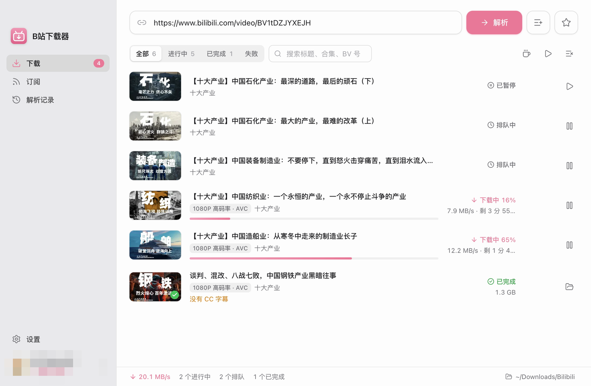
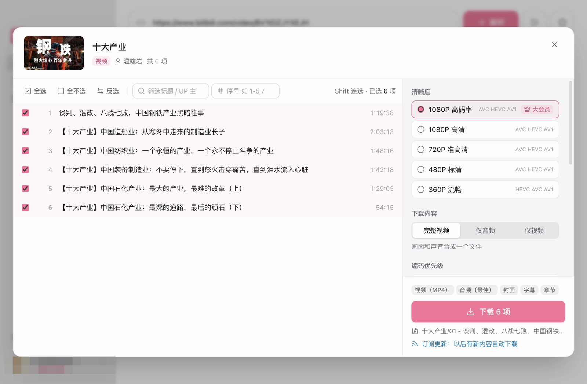

<div align="center">


# Bili Downloader

**Любимые видео с bilibili, YouTube и Douyin — прямо на ваш диск.** Копируете ссылку, вставляете, жмёте «Скачать» — и видео, подборки, аниме и курсы с bilibili скачиваются за один заход, в качестве до 8K / Dolby Vision, а субтитры, данмаку и главы сохраняются рядом; для видео с YouTube и публикаций Douyin тоже достаточно ссылки. Заодно можно стереть водяные знаки с помощью ИИ или вообще поручить всю работу ИИ-агенту. Бесплатно и с открытым исходным кодом, для Windows, macOS и Linux.

[](https://github.com/wangzi6224/bili-downloader/releases/latest)
[](https://github.com/wangzi6224/bili-downloader/releases)
[](https://github.com/wangzi6224/bili-downloader/stargazers)
[](LICENSE)

[](https://github.com/wangzi6224/bili-downloader/releases/latest)
[](https://github.com/wangzi6224/bili-downloader/releases/latest)
[](https://github.com/wangzi6224/bili-downloader/releases/latest)

**[Сайт](https://wangzi6224.github.io/bili-downloader/)** · **[Скачать](https://github.com/wangzi6224/bili-downloader/releases/latest)** · **[Начать](#старт-в-четыре-шага)** · **[Доверить ИИ (MCP)](#пусть-качает-ии-mcp)** · **[Частые вопросы](#частые-вопросы)**

[English](README.md) | [简体中文](README.zh-CN.md) | [日本語](README.ja.md) | [한국어](README.ko.md) | [Français](README.fr.md) | [Italiano](README.it.md) | **Русский** | [हिन्दी](README.hi.md)

<sub>Начиная с v0.13.0 интерфейс доступен на русском, английском, упрощённом китайском, японском, корейском, французском, итальянском и хинди. По умолчанию используется язык системы; его можно изменить в настройках.</sub>

</div>

## Сначала посмотрите

**Удаление водяного знака с ИИ — до и после**: слева то, что скачалось, справа ИИ-ретушь.

https://github.com/user-attachments/assets/835dda86-4575-4311-808b-507c04bbd589

<sub>Источник: «陈翔六点半：一念贪虚妄，半生困赌局», автор — создатель контента bilibili 陈翔六点半. Оригинальное видео: [https://www.bilibili.com/video/BV1vU446BEiU](https://www.bilibili.com/video/BV1vU446BEiU). Все права принадлежат автору; приглашаем посмотреть оригинал на bilibili.<br>Этот фрагмент используется исключительно для демонстрации возможностей программы, только в целях личного изучения, и не подлежит распространению. Если вы считаете, что он нарушает ваши права, свяжитесь с нами через [Issues](https://github.com/wangzi6224/bili-downloader/issues), и он будет оперативно удалён.</sub>

<p align="center">
  
  
</p>

## Что тут есть

| | |
| --- | --- |
| **Качество на максимум** <br> 8K, Dolby Vision, HDR: если ваш аккаунт может это смотреть, вы можете это скачать. Выбирайте AVC / HEVC / AV1, звук — вплоть до Dolby Atmos и Hi-Res FLAC, а исходные потоки по умолчанию сохраняются без перекодирования. | **Просто киньте ссылку** <br> Одиночные и многосерийные видео, подборки, аниме, фильмы, курсы, избранное, «Посмотреть позже», страницы авторов, аудио, рейтинги… целые списки разбираются за один заход, а короткие ссылки b23.tv и текст «поделиться» тоже подойдут. |
| **Удаление водяного знака с ИИ** <br> Водяной знак в углу находится сам, а можно и обвести его рамкой вручную; включите «ИИ-ретушь» — и она кадр за кадром дорисует то, что под ним. | **Субтитры, данмаку и всё остальное** <br> Субтитры CC в `.srt` или прямо в видео, данмаку в `.ass` / `.xml`, плюс главы, обложки и NFO для Kodi / Jellyfin. |
| **Поставил в очередь и ушёл** <br> Многопоточная загрузка с докачкой, ограничение скорости, автоповтор и шаблоны имён; подпишитесь на авторов, избранное или подборки — и новые видео будут скачиваться сами. | **Пусть ИИ сделает всё за вас** <br> Встроенный локальный сервер MCP позволяет Claude и другим ИИ-клиентам искать, разбирать ссылки, ставить загрузки в очередь, убирать водяные знаки и следить за прогрессом. |
| **И YouTube тоже** <br> Видео, Shorts, плейлисты, каналы и YouTube Music, вплоть до 8K / HDR, с субтитрами, созданными вручную или автоматически, главами, отметками фрагментов SponsorBlock и подписками на обновления каналов с автоматической загрузкой новых видео. | **И Douyin тоже** <br> Видео, фотопосты, живые фото, подборки и мини-сериалы, страницы авторов; вставляйте короткую ссылку или весь текст «поделиться». Скачивается версия без водяного знака, вплоть до 4K, если он есть у источника. |
| **Лайки и избранное тоже** <br> Войдите в Douyin, чтобы скачивать свои «Понравившиеся», «Избранное», папки, «Смотреть позже» и историю, и подпишитесь на авторов, подборки, лайки или избранное — новое будет скачиваться само. | **Смена платформы в один клик** <br> Нажмите вверху боковой панели (или переключайтесь по очереди клавишами ⌘⇧Y / Ctrl+Shift+Y) между Bilibili, YouTube и Douyin: три интерфейса со своими темами, а загрузки на всех платформах продолжаются. |

> [!NOTE]
> Это неофициальный проект, не связанный с bilibili, YouTube и Douyin и не одобренный ими. Скачивайте только тот контент, который ваш собственный аккаунт имеет право смотреть, только для личного использования, уважая права авторов и условия использования каждой платформы.

## Старт в четыре шага

1. **Скачайте** установщик для своей системы со страницы [Releases](https://github.com/wangzi6224/bili-downloader/releases/latest):

   | Система | Файл |
   | --- | --- |
   | macOS, Apple Silicon (M1 и новее) | `bili-downloader-<version>-arm64.dmg` |
   | macOS, Intel | `bili-downloader-<version>-x64.dmg` |
   | Windows x64 | `bili-downloader-<version>-x64.exe` |
   | Linux x64 | `bili-downloader-<version>-x86_64.AppImage` или `bili-downloader-<version>-amd64.deb` |

2. **Войдите** в свой аккаунт bilibili (см. [Вход](#вход-и-конфиденциальность)). Без аккаунта приложение не может разбирать ссылки.
3. **Вставьте ссылку.** Приложение подхватит её из буфера обмена, когда вы вернётесь в его окно; также можно нажать <kbd>⌘</kbd><kbd>V</kbd> (<kbd>Ctrl</kbd><kbd>V</kbd> в Windows и Linux) в поле ввода и нажать **解析** (Разобрать).
4. **Выберите и скачайте.** Отметьте элементы (выделить всё, инвертировать выделение, выделить диапазон с <kbd>Shift</kbd> или отфильтровать по названию или номеру, например `1-5,7`), задайте качество, тип результата и дополнительные материалы, затем нажмите **下载** (Скачать).

Вместо ссылки можно ввести ключевые слова: `稍后再看` или `watchlater` («Посмотреть позже»), `每周必看` (лучшее за неделю), `排行榜` (рейтинги).

## Установка

### macOS

1. Скачайте последний `.dmg` со страницы [Releases](https://github.com/wangzi6224/bili-downloader/releases/latest): `arm64` для Apple Silicon, `x64` для Intel.
2. Откройте dmg и перетащите **B站下载器** в **Программы**.
3. Приложение подписано сертификатом Developer ID и нотариально заверено Apple, поэтому открывается как обычно. Версии 0.17.1 и более ранние были подписаны только ad hoc и не заверены, поэтому при первом запуске macOS их блокирует. Попробуйте открыть приложение один раз, затем перейдите в **Системные настройки → Конфиденциальность и безопасность** и нажмите **Всё равно открыть**. (Начиная с macOS 15, правый клик → «Открыть» больше не работает.) Либо выполните:

   ```bash
   xattr -dr com.apple.quarantine "/Applications/B站下载器.app"
   ```

Требуется macOS 12 или новее.

### Windows

Скачайте `bili-downloader-<version>-x64.exe` со страницы [Releases](https://github.com/wangzi6224/bili-downloader/releases/latest) и запустите установщик. Приложение устанавливается для текущего пользователя и не требует прав администратора. Установщик не подписан, поэтому Windows может показать предупреждение о неизвестном издателе.

### Linux

<details>
<summary>AppImage или deb (только 64-битная архитектура x86)</summary>

- **AppImage** (любой дистрибутив, обновляется сам): `bili-downloader-<version>-x86_64.AppImage`. Сделайте файл исполняемым и запустите его:

  ```bash
  chmod +x bili-downloader-*-x86_64.AppImage
  ./bili-downloader-*-x86_64.AppImage
  ```

  Для AppImage нужен FUSE 2. Если AppImage не запускается, установите FUSE 2 (`sudo apt install libfuse2t64` в Ubuntu 24.04 и новее, `libfuse2` в более старых версиях) или запустите файл с ключом `--appimage-extract-and-run`.
- **deb** (Debian, Ubuntu и производные): `bili-downloader-<version>-amd64.deb`. Установите его командой `sudo apt install ./bili-downloader-<version>-amd64.deb` — после этого **B站下载器** появится в меню приложений.

Если окно закрыто и приложение работает в фоне, вернуть его можно щелчком по значку в трее. В GNOME для этого нужно расширение AppIndicator (в Ubuntu оно есть по умолчанию). Строка меню скрыта; чтобы показать её, нажмите <kbd>Alt</kbd>.

</details>

### Обновления

После установки приложение само проверяет обновления. Приложение для macOS, установщик для Windows и AppImage для Linux устанавливают их на месте; версия deb показывает описание изменений и предлагает перейти на страницу загрузки.

Пользователям Windows с версией 0.20.1 или старше нужно один раз установить [версию 0.20.2 вручную](https://github.com/wangzi6224/bili-downloader/releases/tag/v0.20.2); после этого автоматические обновления будут устанавливаться нормально. Если установка обновления Windows не удастся, окно обновления теперь покажет причину.

## Удаление водяного знака с ИИ

В углу висит водяной знак автора? Избавиться от него можно двумя способами:

| Режим | Как работает | Лучше всего подходит для |
| --- | --- | --- |
| **Быстрый** (по умолчанию) | Находит водяной знак в углу и заполняет его окружающими пикселями с помощью фильтра `delogo` из ffmpeg | Быстрого результата, статичного фона |
| **ИИ-ретушь** (AI 精修) | Кадр за кадром дорисовывает то, что под водяным знаком, с помощью модели восстановления изображений [LaMa](https://github.com/advimman/lama) | Гораздо более чистого результата, динамичных сцен |

- Включите его в параметрах загрузки или переключателем **下载后去水印** (Убирать водяной знак после загрузки) над списком загрузок — его можно менять в любой момент.
- В уже скачанном видео можно обвести водяной знак рамкой и убрать его вручную.
- Перед началом ИИ-ретушь показывает примерное время и использует видеокарту, если она есть. Модель (~200 МБ) не входит в установщик: она скачивается при первом использовании ИИ-ретуши и проверяется по SHA-256.
- Удаление водяного знака перекодирует видео. Видео в HDR и Dolby Vision пропускаются.

## Загрузка с YouTube

Нажмите **YouTube** вверху боковой панели (или переключайтесь по очереди клавишами ⌘⇧Y / Ctrl+Shift+Y), чтобы перейти в интерфейс YouTube, и вставьте ссылку. Переключение меняет только интерфейс: у Bilibili, YouTube и Douyin свои списки загрузок, история ссылок и подписки, загрузки на других платформах продолжаются, а точка на переключателе отмечает те, где что-то ещё скачивается.

- **Ссылки**: видео (включая youtu.be), Shorts, записи трансляций, плейлисты, каналы (@handle, /channel/…, с вкладками «Видео» / Shorts / «Трансляции» / «Плейлисты»), YouTube Music; после импорта входа — ещё «Смотреть позже», «Понравившиеся», «Подписки» и «История»
- **Качество и форматы**: до 8K, HDR и 60 к/с; приоритет кодеков AVC / VP9 / AV1; звук Opus или AAC; MP4 / MKV / WebM; только аудио или только видео
- **Дополнительно**: субтитры, созданные вручную или автоматически (на выбранных языках, отдельным файлом `.srt` или со встраиванием в видео), главы, спонсорские вставки, отмеченные как главы с помощью [SponsorBlock](https://sponsor.ajay.app), обложки, NFO
- **Очередь**: общая с Bilibili, поэтому пауза, продолжение, докачка, автоповтор и пропуск уже скачанного работают так же; у YouTube своя папка загрузок и своё ограничение на число одновременных загрузок
- **Подписки**: подпишитесь на плейлист или канал — и новые видео будут скачиваться сами

Поддержка YouTube построена на открытом проекте [yt-dlp](https://github.com/yt-dlp/yt-dlp). Он скачивается при первом переключении на YouTube (около 50 МБ, с официальной страницы релизов на GitHub, с проверкой sha256) и затем автоматически обновляется в фоне, так что размер установщика не меняется; аудио и видео по-прежнему объединяются встроенным ffmpeg.

**Вход** (необязательно): в **Настройки → Основные → Аккаунты YouTube** импортируйте вход в YouTube из браузера или вставьте cookie (`cookies.txt` или JSON из Cookie-Editor). После входа можно скачивать видео для спонсоров канала, видео с возрастными ограничениями и свои списки, а проверка YouTube «подтвердите, что вы не робот» будет появляться реже. Сохраняются только cookie `youtube.com` — в зашифрованном виде на вашем компьютере, в защищённом хранилище системы (Связка ключей macOS, DPAPI в Windows).

**Сеть**: прокси из **Настройки → Сеть и дополнительно** действует и для YouTube. В режиме «Как в системе» правила PAC применяются к адресу YouTube отдельно, поэтому Bilibili может подключаться напрямую, а YouTube — через прокси. Для YouTube также можно указать SOCKS-прокси вручную.

## Загрузка с Douyin

Нажмите **Douyin** вверху боковой панели (или нажимайте ⌘⇧Y / Ctrl+Shift+Y, пока не дойдёте до него) и вставьте ссылку или весь текст «поделиться», скопированный из приложения Douyin. У Douyin своя тема оформления, а также свой список загрузок, история ссылок и подписки.

- **Ссылки**: отдельные видео, фотопосты, живые фото, подборки и мини-сериалы, страницы авторов, короткие ссылки v.douyin.com и тексты «поделиться» целиком; после входа — ещё ваши «Понравившиеся», «Избранное», папки, «Смотреть позже» и история, а на странице подписок можно открыть сохранённые подборки и авторов, на которых вы подписаны
- **Качество и форматы**: версии без водяного знака; качество считается по короткой стороне кадра (вертикальное видео 1080×1920 — это 1080p), вплоть до 4K, если он есть у источника; H.264 / H.265 или «Оригинал» (загруженный исходный файл); MP4 / MKV, только аудио или только видео
- **Фотопосты**: каждый сохраняется в отдельную папку с фотографиями, клипами живых фото и музыкой
- **Дополнительно**: обложки, главы, данмаку (ASS / XML), NFO
- **Очередь**: работают шаблоны имён (с новой переменной `{id}`), пропуск уже скачанного, докачка и ограничение скорости; по умолчанию с Douyin скачивается один элемент за раз, максимум три
- **Подписки**: подпишитесь на страницы авторов, подборки, «Понравившиеся», «Избранное» и другое — новое будет скачиваться само; интервал проверки — не меньше 3 часов

Внутри всё устроено так: приложение использует в скрытой веб-странице подпись запросов самого сайта Douyin. Данные входа хранятся только на вашем компьютере.

**Вход**: отсканируйте QR-код прямо в приложении (рекомендуется), импортируйте вход из браузера или вставьте cookie; можно добавить несколько аккаунтов. Без входа скачиваются только отдельные общедоступные публикации и подборки, а на страницах авторов видна лишь первая страница.

**Проверки безопасности**: поиск, загрузка ответов на комментарии и другие действия иногда вызывают проверку с ползунком. Приложение предупредит вас, а пройти её нужно самому в окне; капчу приложение за вас не решает.

Массовые загрузки и подписки несут риск для аккаунта — сначала прочитайте раздел [Ограничения](#ограничения).

## Пусть качает ИИ (MCP)

Включите в приложении локальный сервер [Model Context Protocol](https://modelcontextprotocol.io) — и ИИ-клиенты вроде Claude смогут за вас искать на bilibili, ставить загрузки в очередь и следить за прогрессом. Настроили — и просто говорите, что нужно:

> Найди на bilibili видео «Blender tutorial» длительностью от 30 до 60 минут, выбери пять самых просматриваемых и скачай их одним пакетом.

Агент вызывает `search_videos`, чтобы найти подходящие видео, `download_batch` с этими пятью видео, чтобы поставить их в очередь одним пакетом, и `get_batch_status`, чтобы следить за прогрессом до завершения.

> Скачай все видео из этой подборки, которых у меня ещё нет, а потом убери водяные знаки ИИ-ретушью: https://space.bilibili.com/…

Здесь агент использует `parse_link`, чтобы развернуть подборку, `download_batch` (уже скачанные элементы пропускаются), `get_batch_status`, чтобы узнать, в каких файлах есть водяной знак и сколько займёт его удаление, и `remove_watermark`, чтобы их очистить.

### Настройка

Откройте **设置 → AI 助手** (Настройки → ИИ-ассистенты) и нажмите **全部安装** (Установить все) или установите для отдельного ассистента. Одним нажатием MCP-сервер и skill добавляются в:

Claude Code · Claude Desktop (macOS, Windows) · Codex · Cursor · Gemini CLI · WorkBuddy · CodeBuddy · Trae CN · Qoder · Qwen Code

- После этого перезапустите ассистента. С этого момента любой разговор, где просят скачать что-то с bilibili или найти там что-то, будет использовать это приложение.
- В настройках ассистентов токен не хранится: они запускают небольшой мост, который читает текущий порт и токен из приложения и, если приложение не запущено, открывает его в фоне (только значок в трее).
- Когда приложение обновляется или перемещается, установленные настройки и skills обновляются при следующем запуске. То, что вы удалили в ассистенте, повторно не устанавливается.

Другие клиенты по-прежнему могут подключаться по HTTP: кнопки в разделе **接入 AI 客户端** (Подключение ИИ-клиента) на той же странице копируют настройки клиента (JSON) или команду Claude Code с уже подставленным токеном доступа.

```json
{
  "mcpServers": {
    "bili-downloader": {
      "type": "http",
      "url": "http://127.0.0.1:39231/mcp",
      "headers": { "Authorization": "Bearer <your-token>" }
    }
  }
}
```

```bash
claude mcp add --transport http bili-downloader http://127.0.0.1:39231/mcp --header "Authorization: Bearer <your-token>"
```

<details>
<summary>Все инструменты MCP</summary>

| Инструмент | Описание |
| --- | --- |
| `get_status` | Вход и статус премиум-подписки (大会员), сводка очереди, свободное место в папке загрузок и на что обратить внимание. Рекомендуется вызывать первым |
| `parse_link` | Разбирает ссылку bilibili (видео, подборка, аниме, курс, избранное, автор…); списки пролистываются автоматически. Идентификаторы элементов постоянны; результаты можно читать частями и разворачивать многочастные видео |
| `download_batch` | Добавляет всю ссылку или выбранные элементы одним пакетом и возвращает `batch_id`. Уже скачанные элементы по умолчанию пропускаются, повторная отправка ничего не скачивает дважды. С параметром `videos` несколько видео, например результаты поиска, объединяются в один пакет |
| `get_batch_status` | Ход пакета: число задач по состояниям, скорость, оценка оставшегося времени, фактическое качество, причины ошибок, а также в каких видео есть водяной знак Bilibili и сколько займёт каждый способ удаления. `wait_seconds` ждёт изменений |
| `list_batches` | Недавно отправленные пакеты |
| `list_tasks` | Показывает задачи постранично, с фильтром по пакету, состоянию или названию |
| `control_tasks` | Массово ставит на паузу, продолжает, повторяет, перекачивает или убирает задачи (скачанные файлы никогда не удаляются), а также отменяет идущее удаление водяного знака |
| `remove_watermark` | Убирает водяной знак из скачанных видео, быстро или ИИ-ретушью; можно сначала только оценить время. Перекодирует видео и заменяет исходный файл |
| `get_settings` / `update_settings` | Читает или меняет папку загрузок, число одновременных загрузок, потоки, ограничение скорости, автоповтор, качество и параметры по умолчанию |
| `search_videos` | Ищет видео по ключевому слову с фильтрами по дате и длительности. В результатах есть название, автор, дата публикации, длительность, число просмотров, категория, теги и краткое описание. Сортировка по общему качеству (`quality`) или по просмотрам, комментариям, данмаку, избранному, длительности и дате публикации — чтобы выбрать лучшие видео |
| `search_users` | Ищет авторов по имени и возвращает `mid`, число подписчиков, число видео и ссылку на канал для `parse_link` |
| `get_video_info` | Сведения о 20 видео за раз: статистика, теги, описание, число частей и подборка, по запросу также похожие видео |
| `get_video_transcript` | О чём видео: ИИ-сводка и план от Bilibili, главы и полные субтитры, которые можно читать по частям. Есть не у всех видео, а для ИИ-сводки и ИИ-субтитров нужен вход в аккаунт |
| `get_video_comments` | Комментарии и ответы с постраничным чтением по курсору, сортировка по популярности или времени. Без входа в аккаунт Bilibili отдаёт лишь несколько |
| `start_login` | Вход, когда приложение не авторизовано: импортирует вход из браузера пользователя (сначала Chrome, используются браузеры, которые удаётся прочитать) или открывает окно входа для сканирования QR-кода при `method=qr` |
| `get_login_status` | Следит за входом или показывает браузеры на этом компьютере. С `wait_seconds` отвечает сразу после успешного входа — так агент узнаёт, что сканирование завершено |

Инструменты YouTube (инструменты пакетов, задач, настроек и истории общие; передайте `platform`, чтобы смотреть только одну платформу):

| Инструмент | Описание |
| --- | --- |
| `youtube_get_status` | Версия и обновления компонента YouTube (yt-dlp), вход, прокси и сводка по очереди YouTube |
| `youtube_parse_link` | Разбирает видео, Shorts, плейлисты, каналы, YouTube Music и личные списки; списки листаются автоматически и читаются частями |
| `youtube_download_batch` | Скачивает одним пакетом видео по ссылке (`url` с `ids` или `all`) или список видео (`videos`); `quality` — максимальная высота кадра в пикселях, а `options` задаёт кодеки, контейнер, звук, языки субтитров, SponsorBlock и другое |
| `youtube_search_videos` / `youtube_search_channels` | Поиск видео (сортировка по релевантности, дате загрузки, просмотрам или рейтингу, фильтры по дате загрузки и длительности) и каналов |
| `youtube_get_video_info` | Сведения о не более чем 20 видео: просмотры, лайки, комментарии, теги, описание, главы, доступные качества и языки субтитров |
| `youtube_get_video_transcript` | Полный текст субтитров с метками времени и главы видео; приоритет у субтитров, созданных вручную; язык можно выбрать, а текст — получать частями |
| `youtube_get_video_comments` | Комментарии и ответы, популярные или новые, постранично |
| `youtube_get_download_quality` | Проверяет, какие качества доступны без входа и с каждым аккаунтом YouTube |
| `youtube_start_login` / `youtube_get_login_status` | Импорт входа в YouTube из браузера и проверка входа |
| `youtube_list_accounts` / `youtube_switch_account` / `youtube_logout_account` | Список, переключение и удаление аккаунтов YouTube; удаление пользователь должен лично подтвердить в диалоговом окне |
| `youtube_update_engine` | Установка или обновление компонента YouTube |

Инструменты Douyin (общие инструменты пакетов, задач, настроек и истории работают и с Douyin; есть также отдельный skill `douyin-downloader`):

| Инструмент | Описание |
| --- | --- |
| `douyin_get_status` | Вход, ожидающие проверки безопасности или ограничения частоты и очередь Douyin. Рекомендуется вызывать первым |
| `douyin_parse_link` | Разбирает ссылку или текст «поделиться»: видео, фотопосты, страницы авторов, подборки и мини-сериалы, а после входа и личные списки; результаты читаются постранично |
| `douyin_download_batch` | Скачивает одним пакетом публикации по ссылке (для одной — `url`, для списка ещё `ids` или `all`) или список публикаций (`videos`); `quality` — короткая сторона кадра в пикселях, а `original=true` скачивает исходный файл |
| `douyin_search_videos` / `douyin_search_users` | Поиск публикаций (сортировка по релевантности, лайкам или дате, фильтры по дате и длительности) и авторов; нужен вход |
| `douyin_get_video_info` | Сведения о не более чем 10 публикациях: лайки, комментарии, добавления в избранное, репосты, хештеги, музыка, главы, доступные качества и подборка |
| `douyin_get_video_comments` | Читает комментарии постранично; для ответов нужен вход |
| `douyin_get_download_quality` | Проверяет, какие качества доступны без входа и с каждым аккаунтом Douyin |
| `douyin_start_login` / `douyin_get_login_status` | Открывает окно входа по QR-коду (по умолчанию) или импортирует вход из браузера и следит за его ходом |
| `douyin_list_accounts` / `douyin_switch_account` / `douyin_logout_account` | Список, переключение и удаление аккаунтов Douyin; удаление пользователь должен лично подтвердить в диалоговом окне |
| `douyin_open_verification` | Когда нужна проверка безопасности, открывает окно, чтобы пользователь прошёл её вручную; автоматически ничего не решается |

</details>

Сервер слушает только `127.0.0.1` (порт можно изменить), требует Bearer-токен и проверяет заголовки `Host` / `Origin` для защиты от DNS rebinding. Токен можно перевыпустить в любой момент.

## Полный список возможностей

<details>
<summary>Поддерживаемые ссылки</summary>

- Видео (BV / av), многосерийные видео, подборки, аниме и фильмы (ep / ss / md), платные курсы
- Папки избранного, «Посмотреть позже», видео, подборки и серии автора (с фильтром по ключевому слову)
- Аудиотреки и аудиоплейлисты (au / am), «每周必看» (лучшее за неделю) и рейтинги популярности по разделам
- Короткие ссылки (b23.tv и другие) и тексты «поделиться», в которых ссылка перемешана с названием
- Разбор нескольких ссылок за раз; постраничная загрузка длинных списков (избранное, страницы авторов)

</details>

<details>
<summary>Качество и форматы</summary>

- Список качеств берётся из API (8K / Dolby Vision / HDR / 4K / 1080P60 / …), уровни только для премиум-подписчиков (大会员) помечены
- Приоритет кодеков AVC / HEVC / AV1; звук вплоть до Dolby Atmos и Hi-Res FLAC без потерь
- Полное видео, только аудио или только видеоряд; MP4 или MKV
- По умолчанию ffmpeg копирует потоки прямо в итоговый файл, без перекодирования; видео перекодируется, только если включено удаление водяного знака

</details>

<details>
<summary>Дополнительные материалы</summary>

- Обложка: сохранить как изображение и/или встроить в файл
- Субтитры CC: сохранить как `.srt` и/или встроить в видео
- Данмаку (бегущие комментарии) в `.ass` и/или `.xml` с настройкой размера шрифта, прозрачности и длительности показа
- Сегменты прогресс-бара bilibili записываются как настоящие главы
- Метаданные NFO для медиатек Kodi / Jellyfin
- Удаление водяного знака, быстрое или ИИ-ретушью (см. [Удаление водяного знака с ИИ](#удаление-водяного-знака-с-ии))

</details>

<details>
<summary>Очередь и сеть</summary>

- Настраиваемые число одновременных загрузок, многопоточная загрузка по сегментам, ограничение скорости и автоматические повторы при сетевых ошибках
- Пауза, продолжение и докачка даже после перезапуска; для задач, которые нельзя скачать, указывается причина
- Прокси: напрямую, системный или вручную; встроенный тест задержки для выбора самого быстрого узла CDN bilibili
- По желанию — запрет сна компьютера (или выключения экрана) во время загрузки и уведомление, когда очередь завершена

</details>

<details>
<summary>Организация и автоматизация</summary>

- Шаблоны имён с переменными (`{title}`, `{series}`, `{index:03}`, `{pubdate:YYYY-MM-DD}`, …), необязательными сегментами и уровнями папок — отдельно для одиночных видео, подборок и аниме
- Распознаёт уже скачанное и спрашивает / пропускает / скачивает заново
- Подписки: периодически проверяет избранное, подборки или авторов и автоматически скачивает новое
- История ссылок, отслеживание буфера обмена, светлая / тёмная тема, работа в фоне, импорт / экспорт настроек
- Встроенные обновления из GitHub Releases с описанием изменений и возможностью пропустить версию

</details>

<details>
<summary>YouTube</summary>

- Видео, Shorts, записи трансляций, плейлисты, все вкладки канала, YouTube Music; после входа — «Смотреть позже», «Понравившиеся», «Подписки» и «История»
- До 8K / HDR / 60 к/с, приоритет кодеков AVC / VP9 / AV1, звук Opus / AAC, MP4 / MKV / WebM
- Субтитры, созданные вручную или автоматически (на выбранных языках), главы, отметки фрагментов SponsorBlock, обложки, NFO
- Несколько аккаунтов YouTube; сравнение доступного качества для каждого аккаунта
- Подписки на плейлисты и каналы; отдельная папка загрузок и отдельное ограничение одновременных загрузок
- Переключение между интерфейсами Bilibili, YouTube и Douyin в один клик, загрузки на всех платформах при этом продолжаются

</details>

<details>
<summary>Douyin</summary>

- Видео, фотопосты, живые фото, подборки и мини-сериалы, страницы авторов, короткие ссылки и тексты «поделиться»; после входа — «Понравившиеся», «Избранное», папки, «Смотреть позже» и история
- Без водяного знака; качество по короткой стороне, вплоть до 4K, если он есть у источника, H.264 / H.265 и «Оригинал»; MP4 / MKV, только аудио или только видео
- Обложки, главы, данмаку (ASS / XML), NFO, шаблоны имён, пропуск уже скачанного, докачка, ограничение скорости
- Вход по QR-коду, импортом из браузера или вставкой cookie; несколько аккаунтов
- Подписки на страницы авторов, подборки, «Понравившиеся», «Избранное» и другое с интервалом проверки не меньше 3 часов

</details>

## Вход и конфиденциальность

Войдите — и сможете скачивать всё, что может смотреть ваш аккаунт, в любом доступном ему качестве, включая 1080P и выше и премиум-контент. Войти можно тремя способами:

- **从浏览器导入** (Импорт из браузера): использует cookie входа из Chrome, Edge, Brave, Arc (только macOS), Vivaldi, Opera, Chromium, Firefox или Safari (только macOS).
  - Если macOS блокирует чтение, выберите папку данных нужного браузера в окне входа. При импорте из браузеров на базе Chromium также может потребоваться доступ к Связке ключей.
  - В Linux браузеры на базе Chromium хранят ключ cookie в системной связке ключей (GNOME Keyring / libsecret). Приложение читает его через `secret-tool` (`sudo apt install libsecret-tools`); при этом может потребоваться разблокировать связку ключей. Также поддерживаются Firefox из Snap и Flatpak и Chromium из Snap.
  - В Windows браузеры на базе Chromium блокируют базу данных cookie, пока они запущены, поэтому перед импортом полностью закройте браузер (включая фоновые процессы). Cookie, записанные Chrome 127 и новее, защищены шифрованием с привязкой к приложению и не могут быть импортированы; если cookie входа среди них, воспользуйтесь вместо этого входом в приложении или вставьте строку cookie.
- **在应用内登录** (Вход в приложении): открывает официальную страницу входа bilibili — по QR-коду, паролю или SMS.
- **手动粘贴 Cookie** (Вставить cookie вручную): строка cookie через точку с запятой или JSON, экспортированный расширением браузера.

Приложение проверяет вход при запуске, при возвращении в окно, при разборе ссылок и всякий раз, когда API сообщает об истёкшей сессии. Если вход истёк, приложение попросит войти снова, приостановит получение потоков и автоматически продолжит очередь после повторного входа. Выход удаляет только собственные cookie приложения и не разлогинивает вас в браузере.

**Куда уходят ваши данные**

- Ваши cookie bilibili хранятся в собственной папке данных приложения и отправляются только в bilibili. Они никогда не передаются ИИ-клиентам через MCP.
- Загрузка, сведение и удаление водяного знака выполняются локально. Нет ни регистрации, ни телеметрии, ни наших серверов посередине.
- Приложение обращается только к используемым вами площадкам (bilibili, YouTube, Douyin и их доменам доставки контента), к GitHub (проверка обновлений и загрузка компонента YouTube) и к ModelScope или Hugging Face (однократная загрузка модели ИИ-ретуши). При включённом SponsorBlock yt-dlp также обращается к этому сервису.
- Клиент MCP может переключить аккаунт или выйти из указанного аккаунта по вашему запросу. Если сначала нужно закрыть браузер (в Windows база cookie заблокирована, пока браузер запущен), приложение спросит вас в диалоговом окне, и подтвердить можете только вы.

## Частые вопросы

<details>
<summary>Можно пользоваться без входа?</summary>

Нет. Чтобы разбирать ссылки, приложению нужен вход, а качество вам доступно то, которое может смотреть ваш аккаунт.

</details>

<details>
<summary>Почему нельзя выбрать 1080P / 4K / 8K?</summary>

Список качеств приходит напрямую от bilibili для вашего аккаунта. Более высокие уровни (1080P+ с высоким битрейтом, 4K, 8K, HDR, Dolby Vision) обычно требуют премиум-подписки (大会员), и не каждое видео загружено во всех качествах.

</details>

<details>
<summary>macOS пишет, что приложение не открыть. Что делать?</summary>

Версии 0.18.0 и новее подписаны и нотариально заверены Apple и открываются как обычно. Версии 0.17.1 и более ранние не заверены: откройте приложение один раз, затем нажмите **Всё равно открыть** в **Системные настройки → Конфиденциальность и безопасность** или выполните команду `xattr` из раздела [Установка](#macos).

</details>

<details>
<summary>Windows пишет «Система Windows защитила ваш компьютер». Что делать?</summary>

Установщик не подписан. Нажмите **Подробнее → Выполнить в любом случае**.

</details>

<details>
<summary>Почему у задачи статус 无法下载 (скачать невозможно)?</summary>

Контент с DRM, с региональными ограничениями или недоступный вашему аккаунту скачать нельзя. В задаче указана причина.

</details>

<details>
<summary>Почему удаление водяного знака такое медленное?</summary>

ИИ-ретушь перерисовывает каждый кадр, поэтому она намного медленнее быстрого режима, особенно без видеокарты. Перед началом приложение показывает примерное время; используйте быстрый режим, когда скорость важнее качества.

</details>

<details>
<summary>Есть ли интерфейс на русском или английском?</summary>

Да. Начиная с v0.13.0 интерфейс поддерживает русский и ещё семь языков. По умолчанию используется язык системы; его можно изменить в настройках.

</details>

## Ограничения

- Контент с DRM, с региональными ограничениями или недоступный вашему аккаунту скачать нельзя. Такие задачи помечаются как **无法下载** (скачать невозможно) с указанием причины.
- YouTube: контент с DRM, например фильмы из раздела «Фильмы и сериалы», и контент только для подписчиков YouTube Premium не поддерживаются; трансляции можно скачать после их окончания; YouTube часто ограничивает частоту запросов на получение автоматически переведённых субтитров — если скачать их не удалось, повторите попытку позже.
- Douyin: прямые трансляции, ссылки на страницы поиска, страницы звуков и хештегов не поддерживаются; субтитров и ИИ-сводок нет.
- Риски при работе с Douyin: массовые загрузки и подписки могут вызвать проверки безопасности Douyin или ограничения аккаунта, поэтому используйте запасной аккаунт и не частите. Только для личного изучения и резервного копирования контента, который вы вправе скачивать; соблюдайте условия использования платформы и законы об авторском праве — всё на ваш страх и риск. Douyin часто меняется, и эти функции могут перестать работать в любой момент.
- Поддерживаются Windows x64, macOS x64 / arm64 и Linux x64. Сборки для Windows и Linux на ARM не предоставляются.

## Сборка из исходников

Нужны Windows, macOS или Linux, Node.js 22.12 или новее и npm.

```bash
git clone https://github.com/wangzi6224/bili-downloader.git
cd bili-downloader
npm install
npm run dev          # режим разработки
npm test             # модульные тесты
npm run typecheck    # проверка типов
npm run build:mac    # в macOS: собрать dmg / zip для x64 и arm64 в dist/
npm run build:linux  # в Linux: собрать AppImage / deb для x64 в dist/
npm run build:win    # в Windows: собрать установщик NSIS для x64 в dist/
```

Процесс разработки описан в [CONTRIBUTING.md](CONTRIBUTING.md) (на английском), упаковка и выпуск версий — в [docs/RELEASING.md](docs/RELEASING.md) (на китайском).

## Структура проекта

```
src/main/auth               Вход: хранение cookie, окно входа, импорт из браузера, обнаружение истечения сессии
src/main/bili               API bilibili: подпись WBI, разбор видео / аниме / курсов / списков, потоки, субтитры, данмаку
src/main/download           Очередь загрузок, докачка, сведение через ffmpeg, дополнительные материалы (обложка, субтитры, NFO…)
src/main/watermark          Поиск и удаление водяного знака (delogo из ffmpeg); ai/ — ИИ-ретушь (модель LaMa на onnxruntime)
src/main/net                Прокси и выбор CDN
src/main/update             Встроенные обновления: проверка update.json, проверка загрузок, установка обновлений .app / AppImage / NSIS
src/main/mcp                Локальный сервер MCP
src/main/agents             Установка MCP-сервера и skill в ИИ-ассистенты в один клик
src/bridge                  stdio-мост, который запускают ИИ-ассистенты для связи с MCP-сервером
src/main/subscriptions.ts   Подписки
src/shared                  Общие для всех процессов типы, разбор ссылок и шаблоны имён
src/renderer                Интерфейс (React + Tailwind CSS + zustand)
scripts                     Загрузка ffmpeg, генерация значков, публикация релизов
website                     Сайт продукта (Next.js, публикуется на GitHub Pages)
```

## Участие в разработке

Issues и pull requests приветствуются. Пожалуйста, сначала прочитайте [CONTRIBUTING.md](CONTRIBUTING.md). Нравится? Поставьте ⭐ — так его смогут найти больше людей.

## Благодарности

- [bilibili-API-collect](https://github.com/SocialSisterYi/bilibili-API-collect) за документацию API bilibili
- [yt-dlp](https://github.com/yt-dlp/yt-dlp) за разбор и загрузку с YouTube и [SponsorBlock](https://sponsor.ajay.app) за данные о спонсорских фрагментах
- [FFmpeg](https://ffmpeg.org) и [ffmpeg-static](https://github.com/eugeneware/ffmpeg-static)
- [Electron](https://www.electronjs.org), [electron-vite](https://electron-vite.org), [electron-builder](https://www.electron.build)
- [React](https://react.dev), [Tailwind CSS](https://tailwindcss.com), [zustand](https://github.com/pmndrs/zustand), [Lucide](https://lucide.dev)

## Лицензия

[MIT](LICENSE) © wangzi6224

В приложение входят статические сборки FFmpeg из [ffmpeg-static](https://github.com/eugeneware/ffmpeg-static) (`b6.1.1`). FFmpeg работает как отдельная программа под собственной лицензией и не подпадает под указанную выше лицензию MIT. Текст его лицензии поставляется вместе с приложением в `Contents/Resources/ffmpeg/LICENSE` (macOS) / `resources/ffmpeg/LICENSE` (Windows и Linux); см. также [FFmpeg License and Legal Considerations](https://ffmpeg.org/legal.html).

ИИ-ретушь запускает модель восстановления изображений [LaMa](https://github.com/advimman/lama) (Apache-2.0; ONNX-версия из [Carve/LaMa-ONNX](https://huggingface.co/Carve/LaMa-ONNX)) через [onnxruntime](https://github.com/microsoft/onnxruntime) (MIT, входит в приложение). Модель не входит в установщик: она скачивается при первом использовании ИИ-ретуши.
