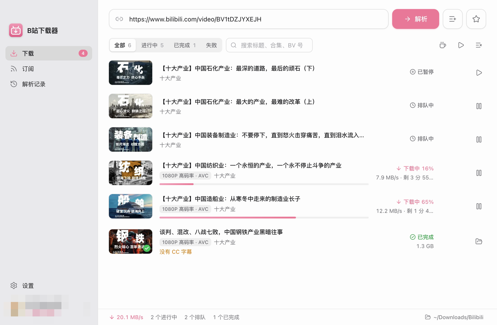
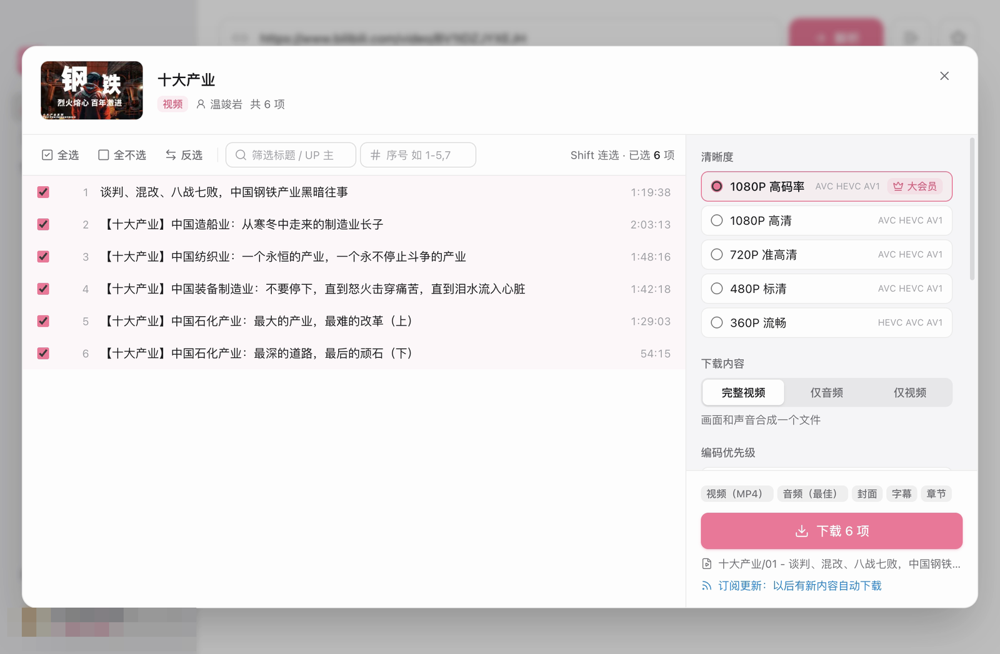

<div align="center">


# B站下载器

粘贴 B站链接，就能下载视频、分P、合集、番剧和电影的 macOS 桌面应用。

[](https://github.com/wangzi6224/bili-downloader/releases/latest)
[](https://github.com/wangzi6224/bili-downloader/releases)


[](LICENSE)

[English](README.md) | **简体中文** | [日本語](README.ja.md) | [한국어](README.ko.md) | [Français](README.fr.md) | [Italiano](README.it.md) | [Русский](README.ru.md) | [हिन्दी](README.hi.md)

</div>

<p align="center">
  
  
</p>

> [!NOTE]
> 本项目是非官方工具，与哔哩哔哩无关，也未获其认可。请只下载你本人账号有权观看的内容，仅用于个人用途，并尊重创作者的权益和 B站的用户协议。

## 功能

### 支持的链接

- 普通视频（BV / av）、分P、合集、番剧和电影（ep / ss / md）、付费课程
- 收藏夹、稍后再看、UP 主的投稿、合集和系列（可按关键词筛选）
- 音频和歌单（au / am）、每周必看、各分区排行榜
- b23.tv 等短链，以及夹带标题的分享文案
- 一次解析多个链接；收藏夹、UP 主投稿等分页列表可以逐页加载

### 清晰度与格式

- 清晰度列表来自接口（8K / 杜比视界 / HDR / 4K / 1080P60 …），标出需要大会员的档位
- 编码优先级可选 AVC / HEVC / AV1；音轨最高支持杜比全景声和 Hi-Res 无损 FLAC
- 完整视频、仅音频或仅视频；封装为 MP4 或 MKV
- 用 ffmpeg 直接复制流合并，不重新编码

### 附加内容

- 封面：另存为图片，或写入文件
- CC 字幕：另存为 `.srt`，或写入视频
- 弹幕：`.ass` 和 / 或 `.xml`，字号、不透明度、停留时间可调
- 把 B站进度条上的分段写成真正的章节
- 为 Kodi / Jellyfin 媒体库生成 NFO 元数据

### 下载队列与网络

- 并发数、单文件分段多线程、限速、网络错误自动重试均可调
- 暂停、继续、断点续传（重启后仍可续传）；无法下载的任务写明原因
- 代理：直连、系统代理或手动设置；内置测速，可选择最快的 B站 CDN 节点
- 下载期间可以阻止系统睡眠或保持屏幕常亮，队列全部完成后发系统通知

### 整理与自动化

- 命名模板：支持变量（`{title}`、`{series}`、`{index:03}`、`{pubdate:YYYY-MM-DD}` …）、可选段和目录层级，单个视频、合集和番剧分别设置
- 识别已经下载过的内容，可选询问、跳过或重新下载
- 订阅：定期检查收藏夹、合集、UP 主等来源，有新内容就自动下载
- 解析记录、剪贴板监听、浅色 / 深色主题、后台运行、设置导入导出
- 应用内更新：从 GitHub Releases 获取新版本，显示更新说明，可以跳过某个版本

### AI 集成

- 本地 [MCP](https://modelcontextprotocol.io) 服务，让 Claude 等 AI 客户端解析链接、创建下载、查看进度（见下文 **MCP 服务**）

## 安装

1. 从 [Releases](https://github.com/wangzi6224/bili-downloader/releases/latest) 下载最新的 `.dmg`：
   - Apple 芯片（M1 及以后）：`bili-downloader-<version>-arm64.dmg`
   - Intel 芯片：`bili-downloader-<version>-x64.dmg`
2. 打开 dmg，把 **B站下载器** 拖到 **应用程序**。
3. 应用使用 ad-hoc 签名、没有公证，第一次打开会被 macOS 拦截。先尝试打开一次，再到 **系统设置 → 隐私与安全性** 里点 **仍要打开**（macOS 15 起右键 →“打开”已不再有效）。也可以在终端运行：

   ```bash
   xattr -dr com.apple.quarantine "/Applications/B站下载器.app"
   ```

需要 macOS 12 或更高版本。界面目前只有简体中文。

安装后应用会自动检查更新，并可以直接下载安装新版本。

## 快速上手

1. 登录 B站账号（见下文 **登录**）。应用需要登录后才能解析链接。
2. 复制 B站链接。切回应用时会自动识别剪贴板，也可以在输入框里按 <kbd>⌘</kbd><kbd>V</kbd> 粘贴后点 **解析**。
3. 勾选要下载的条目：支持全选、反选、<kbd>Shift</kbd> 连选，以及按标题或序号（如 `1-5,7`）筛选。
4. 选择清晰度、下载内容和附加内容，点 **下载**。

也可以直接输入这些关键词代替链接：`稍后再看` 或 `watchlater`、`每周必看`、`排行榜`。

## 登录

登录后才能拿到你自己账号可以观看的清晰度和内容（1080P 及以上、大会员内容）。有三种方式：

- **从浏览器导入**：复用 Chrome、Edge、Brave、Arc、Vivaldi、Chromium 或 Firefox 里的登录 cookie。Chrome、Edge、Brave 的数据受 macOS 隐私保护，需要先在 **系统设置 → 隐私与安全性 → 完全磁盘访问权限** 里打开本应用并重启应用；导入 Chromium 系浏览器时还会弹出钥匙串授权。
- **在应用内登录**：打开 B站官方登录页，支持扫码、密码和短信登录。
- **手动粘贴 Cookie**：分号分隔的 cookie 字符串，或浏览器插件导出的 JSON。

启动、切回窗口、解析链接以及接口返回登录失效时，应用都会检查登录状态。登录过期后会弹出登录对话框，下载队列暂停取流，重新登录后自动继续。退出登录只清除应用自己的 cookie，不会把浏览器里的登录一起退出。

## MCP 服务

应用可以开启一个本地 [Model Context Protocol](https://modelcontextprotocol.io) 服务，让 AI 客户端操作下载队列。

1. 在 **设置 → 网络与高级 → MCP 服务** 里打开 **开启 MCP 服务**。
2. 用同一区域的按钮复制客户端配置（JSON）或 Claude Code 命令，里面已经带好访问令牌。

```json
{
  "mcpServers": {
    "bili-downloader": {
      "type": "http",
      "url": "http://127.0.0.1:39231/mcp",
      "headers": { "Authorization": "Bearer <your-token>" }
    }
  }
}
```

```bash
claude mcp add --transport http bili-downloader http://127.0.0.1:39231/mcp --header "Authorization: Bearer <your-token>"
```

| 工具 | 说明 |
| --- | --- |
| `get_status` | 登录和大会员状态、队列汇总、下载目录剩余空间和需要注意的提示，建议第一个调用 |
| `parse_link` | 解析 B站链接（视频、合集、番剧、课程、收藏夹、UP 主等），列表会自动翻页；条目 id 稳定，可分段读取、展开分P |
| `download_batch` | 把整个链接或选中的条目作为一个批次加入下载，返回 `batch_id`；默认跳过已下载的，重复提交不会重复下载 |
| `get_batch_status` | 批次进度：各状态的数量、速度、预计剩余时间、实际清晰度、失败原因；可以用 `wait_seconds` 等待 |
| `list_batches` | 最近提交的批次 |
| `list_tasks` | 分页查看任务，可按批次、状态、标题筛选 |
| `control_tasks` | 批量暂停、继续、重试、重新下载或移除任务（不会删除已下载的文件） |
| `get_settings` / `update_settings` | 读取、修改下载目录、并发数、线程数、限速、自动重试、默认清晰度和下载选项 |

服务只监听 `127.0.0.1`（端口可改），必须带 Bearer 令牌，并校验 `Host` / `Origin` 以防 DNS 重绑定。令牌可以随时重新生成。

## 限制

- 不支持带 DRM 加密的片源、地区限制的内容，以及账号没有权限观看的内容。这些任务会标为 **无法下载** 并写明原因。
- 仅支持 macOS。

## 从源码构建

需要 macOS、Node.js 22.12 或更高版本以及 npm。

```bash
git clone https://github.com/wangzi6224/bili-downloader.git
cd bili-downloader
npm install
npm run dev          # 开发模式
npm test             # 单元测试
npm run typecheck    # 类型检查
npm run build:mac    # 在 dist/ 里生成 x64 和 arm64 的 dmg / zip
```

开发流程见 [CONTRIBUTING.md](CONTRIBUTING.md)（英文），打包和发布见 [docs/RELEASING.md](docs/RELEASING.md)。

## 目录结构

```
src/main/auth               登录：cookie 存储、应用内登录窗口、浏览器导入、过期检测
src/main/bili               B站接口：WBI 签名、视频 / 番剧 / 课程 / 列表解析、取流、字幕、弹幕
src/main/download           下载队列、断点续传、ffmpeg 合并、附加内容（封面、字幕、NFO…）
src/main/net                代理和 CDN 选择
src/main/update             应用内更新：检查 update.json、下载校验、替换 .app
src/main/mcp                本地 MCP 服务
src/main/subscriptions.ts   订阅
src/shared                  各进程共用的类型、链接识别和命名模板
src/renderer                界面（React + Tailwind CSS + zustand）
scripts                     下载 ffmpeg、生成图标、发布新版本
```

## 参与贡献

欢迎提交 Issue 和 Pull Request，提交前请先阅读 [CONTRIBUTING.md](CONTRIBUTING.md)。

## 致谢

- [bilibili-API-collect](https://github.com/SocialSisterYi/bilibili-API-collect) 整理的 B站接口文档
- [FFmpeg](https://ffmpeg.org) 和 [ffmpeg-static](https://github.com/eugeneware/ffmpeg-static)
- [Electron](https://www.electronjs.org)、[electron-vite](https://electron-vite.org)、[electron-builder](https://www.electron.build)
- [React](https://react.dev)、[Tailwind CSS](https://tailwindcss.com)、[zustand](https://github.com/pmndrs/zustand)、[Lucide](https://lucide.dev)

## 许可证

[MIT](LICENSE) © wangzi6224

应用内置了来自 [ffmpeg-static](https://github.com/eugeneware/ffmpeg-static)（`b6.1.1`）的静态 FFmpeg。FFmpeg 作为独立程序运行，遵循它自己的许可证，不在上面的 MIT 许可范围内。它的许可证文本随应用附带，位于 `Contents/Resources/ffmpeg/LICENSE`，另见 [FFmpeg 许可与法律说明](https://ffmpeg.org/legal.html)。
